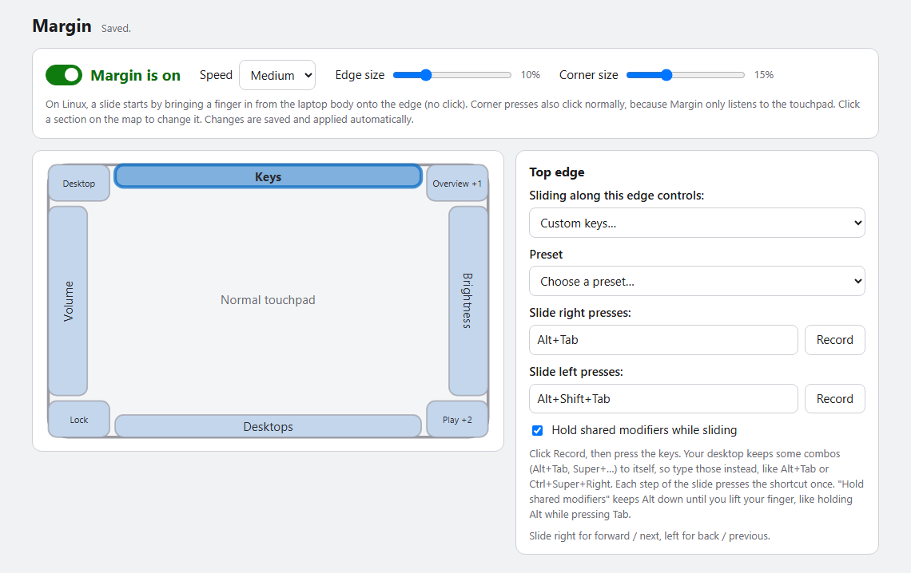
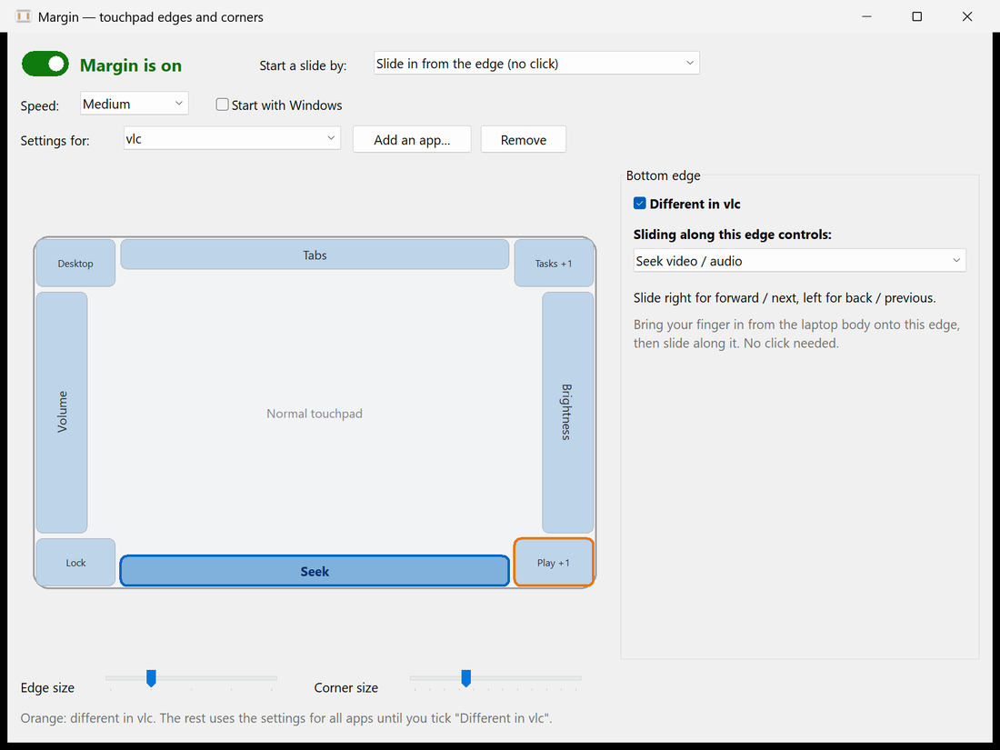

<p align="center">
  
</p>

<h1 align="center">Margin</h1>

<p align="center">
  <strong>Turn the edges and corners of your touchpad into controls.</strong><br>
  Slide along an edge for volume, brightness, seeking or Alt+Tab. Press a corner to run anything. You choose what each one does.
</p>

<p align="center">
  
  
  
  
</p>

<p align="center">
  
</p>

Most laptop touchpads only use their middle for gestures. Margin uses the unused strip around the outside:

- **Slide a finger along an edge** to change volume or screen brightness, scrub a video, zoom, flip through windows or tabs, skip tracks, or switch virtual desktops. No function keys needed.
- **Press a corner** once, twice or three times, or press and hold it, to run a different action each time: mute, screenshot, lock the PC, open an app or website, press any shortcut, or run a command.
- **Record your own shortcuts** for each slide direction, so an edge can drive any app.
- **Change things per app** (Windows): the bottom edge can seek in your video player and switch tabs in your browser.

Everything in the middle of the touchpad stays a normal touchpad. Margin is one small native program (about 0.6 MB) that needs nothing installed, uses no network and sends no telemetry.

## Install

**Windows 10 / 11.** Open PowerShell and run:

```powershell
irm https://raw.githubusercontent.com/arxhr007/margin/main/scripts/install.ps1 | iex
```

**Linux** (64-bit Intel/AMD, any distribution with systemd). Run in a terminal:

```sh
curl -fsSL https://raw.githubusercontent.com/arxhr007/margin/main/scripts/install.sh | sh
```

Both scripts download the latest release, check its SHA-256, install it for your user only, and start it. They are short, so you can [read the Windows one](scripts/install.ps1) and [the Linux one](scripts/install.sh) first.

<details>
<summary><b>Installer options, manual download, build from source</b></summary>

**Windows options** (set before the command):

```powershell
$env:MARGIN_AUTOSTART = 1          # also start Margin when you sign in
$env:MARGIN_VERSION = "v0.4.0"     # a specific release instead of the latest
$env:MARGIN_UNINSTALL = 1          # remove Margin (your settings are kept)
```

It installs to `%LOCALAPPDATA%\Programs\Margin`, adds a Start Menu shortcut and needs no administrator rights. A file fetched this way is not marked as "downloaded from the internet", so SmartScreen does not warn about it.

**Linux options** (after `sh -s --`):

```sh
curl -fsSL https://raw.githubusercontent.com/arxhr007/margin/main/scripts/install.sh | sh -s -- --version v0.4.0
#   --no-service       don't set up the systemd user service
#   --no-permissions   don't touch udev rules or groups
#   --uninstall        remove Margin (your settings are kept)
```

It installs `~/.local/bin/margin`, does one `sudo` step for the permissions described under [Linux](#linux), and sets up a systemd user service that starts with your desktop session.

**Manual download.** Every [release](../../releases) has `margin.exe` (Windows) and `margin-linux-x86_64` (Linux, static, no dependencies), each with a `.sha256` file. There is no prebuilt Linux arm64 binary yet; on arm64, build from source.

**Build from source** (needs the [Rust toolchain](https://rustup.rs); on Windows also the "Desktop development with C++" build tools):

```sh
git clone https://github.com/arxhr007/margin.git
cd margin
cargo build --release     # target/release/margin  (margin.exe on Windows)
```

> The Windows exe is not code-signed. If you download it in a browser, SmartScreen may say "Windows protected your PC": choose **More info → Run anyway**. The PowerShell installer avoids this.
</details>

## Contents

[Screenshots](#screenshots) · [Using Margin](#using-margin) · [Custom keys](#custom-keys) · [Per-app settings](#per-app-settings) · [Linux](#linux) · [Settings file](#settings-file) · [Troubleshooting](#troubleshooting) · [How it works](#how-it-works) · [Build and test](#build-and-test) · [Related projects](#related-projects) · [Code signing policy](#code-signing-policy) · [Contributing](#contributing) · [License](#license)

## Screenshots

<table>
  <tr>
    <td width="50%"><br><sub><b>Custom keys.</b> Record a shortcut for each slide direction, or pick a preset.</sub></td>
    <td width="50%"><br><sub><b>Corners.</b> One, two or three presses, or a press and hold, each run a different action.</sub></td>
  </tr>
</table>

<p align="center">
  
  &nbsp;&nbsp;&nbsp;
  
  <br><sub>The small on-screen display for brightness and seeking on Windows. Volume uses the normal Windows volume flyout.</sub>
</p>

<p align="center">
  
  <br><sub>On Linux the settings open as a page in your browser (<code>margin settings</code>), with the same map and editors.</sub>
</p>

## Using Margin

On Windows, left-click the tray icon (or launch `margin.exe` again) to open settings. On Linux, run `margin settings`.

### Edges: slide along them

Click an edge on the touchpad map, then choose what sliding along it controls:

| Action | Slide one way | Slide the other way |
| --- | --- | --- |
| **Volume** | louder | quieter |
| **Screen brightness** | brighter | dimmer |
| **Seek video / audio** | forward (shows `+10s`) | back |
| **Zoom** | zoom in | zoom out (Ctrl + mouse wheel) |
| **Switch tabs / windows (Alt+Tab)** | next window | previous window (the Alt+Tab picker stays open until you lift your finger) |
| **Previous / next track** | next | previous |
| **Switch virtual desktops** | desktop to the right | desktop to the left |
| **Custom keys** | your shortcut | your other shortcut |

Slide **up or right** for "more / next" and **down or left** for "less / previous". The *Speed* setting changes how far you must slide per step. On Windows, hold **Ctrl + Shift** while sliding for fine steps.

### Two ways to start a slide

Pick one under *Start a slide by* (Windows; Linux always uses the first):

- **Slide in from the edge** (default): bring a finger in from the laptop body onto the edge, then move along it. No click. A finger that first lands inside the touchpad, or any two-finger contact, never triggers it.
- **Press the edge until it clicks, then slide**: rest a finger on the edge, press until the touchpad clicks, and slide without letting go. The hardest to trigger by accident.

On Windows, while a slide runs the pointer stays still and nothing is clicked underneath.

### Corners: press them

Press a corner until the touchpad physically clicks. Taps are ignored. Each corner can run a different action for **1, 2 or 3 presses**, and one more for **press and hold** (keep it pressed for half a second):

Mute · Play / pause · Next / previous track · Screenshot · Task View / overview · Show desktop · Lock the PC · Notifications · **Open an app** · **Open a website** · **Press a shortcut** · **Run a command** · Nothing

Defaults: top-left = show desktop, top-right = Task View (1 press) / notifications (2), bottom-left = lock, bottom-right = play/pause (1) / next (2) / previous (3). On the edges: left = volume, right = brightness, top = switch windows, bottom = switch virtual desktops.

The **Edge size** and **Corner size** sliders change how big each zone is. The map always shows the real zones. On Windows, orange dots on the map show where your fingers are on the pad.

## Custom keys

Choose **Custom keys…** for an edge to make it send your own shortcuts. (The ready-made **Switch tabs (Alt+Tab)** entry is fixed; its **Change the keys…** button turns it into Custom keys, starting from Alt+Tab.)

1. Pick a **preset**, or click **Record** next to *Slide right presses* and press the keys.
2. Do the same for the other direction.
3. Tick **Hold shared modifiers while sliding** for Alt+Tab-style pickers: the modifiers both shortcuts share (Alt) stay down until you lift your finger.

Your system keeps a few combinations to itself (Alt+Tab, anything with the Windows or Super key), so the Record button can't capture them. **Type them in the box instead.** Shortcut text looks like `Ctrl+Shift+Tab`, `Alt+Tab`, `Win+Ctrl+Right` (`Win` is the Super key on Linux), `Ctrl+PageDown` or `F11`.

| Preset | Slide right / up | Slide left / down | Hold |
| --- | --- | --- | --- |
| Switch windows | `Alt+Tab` | `Alt+Shift+Tab` | yes |
| Switch browser tabs | `Ctrl+Tab` | `Ctrl+Shift+Tab` | no |
| Next / previous tab | `Ctrl+PageDown` | `Ctrl+PageUp` | no |
| Scroll | `PageUp` | `PageDown` | no |
| Arrow keys | `Right` | `Left` | no |
| Redo / undo | `Ctrl+Y` | `Ctrl+Z` | no |

## Per-app settings

On Windows, any edge or corner can do something else while a particular app is the window in front. In the settings window, choose **Add an app…** next to **Settings for**, and pick the app's program (for example `vlc.exe`). With that app chosen in the list, click a section on the map and tick **Different in vlc** to give it its own action. Sections with their own action for the chosen app have an orange outline; the rest follow the settings for all apps.

<p align="center">
  
</p>

Margin checks which app is in front when a slide or press starts, and a slide keeps those settings until you lift your finger, even when it switches to another app (as Alt+Tab does). On Linux, per-app settings in the file are kept but not used, because Wayland has no common way to tell which app is in front.

## Linux

Margin on Linux is a small background program (a systemd user service) plus a settings page in your browser. It works on Wayland and X11 alike, because it reads the touchpad and sends keys at the kernel level instead of talking to a display server. **This is the first Linux release (v0.4.0):** it is tested end to end with a virtual touchpad and in CI, but not yet across many real laptops and desktops, so bug reports are welcome.

```sh
margin settings      # open the settings page (it prints a private link and opens your browser)
margin --diag        # run in a terminal and print every touch frame and gesture
margin config-path   # where settings.json lives (~/.config/margin/settings.json)
systemctl --user status margin
```

**Requirements:** a touchpad that your system handles as a multitouch device (nearly every modern laptop; old "semi-MT" Synaptics pads aren't supported), and systemd for the automatic start (otherwise run `margin` yourself).

### Permissions

Margin needs to **read the touchpad** (`/dev/input/event*`, group `input`) and **create a virtual keyboard** (`/dev/uinput`). The installer does this with one `sudo` step: it adds a udev rule that gives the `input` group access to `/dev/uinput`, loads the `uinput` module at boot, and adds you to the `input` group. **Log out and back in once** afterwards. To do it by hand:

```sh
sudo groupadd -f input && sudo usermod -aG input "$USER"
echo 'KERNEL=="uinput", MODE="0660", GROUP="input", OPTIONS+="static_node=uinput"' | sudo tee /etc/udev/rules.d/60-margin-uinput.rules
echo uinput | sudo tee /etc/modules-load.d/margin-uinput.conf
sudo modprobe uinput && sudo udevadm control --reload-rules && sudo udevadm trigger
```

> Being in the `input` group lets any program you run read all your input devices, including the keyboard. Margin itself only opens devices that look like touchpads, and its code is small enough to check, but you should know what the group allows.

### What is different from Windows

| | Windows | Linux |
| --- | --- | --- |
| Start a slide | slide in from the edge, or press and slide | slide in from the edge only |
| Pointer while sliding | frozen | still moves (Margin only listens to the touchpad) |
| Corner presses | hidden from other apps | the press also clicks, wherever the pointer is |
| Brightness and volume | exact steps, Margin's own on-screen display | media keys: your desktop sets the step and shows its own display |
| Fine steps (Ctrl+Shift) | yes | not yet |
| Switch virtual desktops | Ctrl+Win+Left/Right | Ctrl+Super+Left/Right; some desktops use other keys, so use Custom keys there |
| Settings | native window and tray icon | page in your browser, no tray icon |
| Per-app settings | yes | not yet: the settings for all apps are used |

`margin settings` only listens on `127.0.0.1` and every request needs a random key that is part of the link it prints, so other programs and web pages can't change your settings (they could otherwise add a "run a command" corner). Changes you make there are applied by the running program within a second.

## Settings file

Settings are saved automatically to `%APPDATA%\Margin\settings.json` on Windows and `~/.config/margin/settings.json` on Linux, so you can also edit them by hand (comments and trailing commas are allowed). The running program applies a saved change within a second. If the file has a mistake, Margin writes the error to its log, keeps a copy of your file as `settings.json.broken`, and carries on with the settings it already had (the defaults, if it was just starting). It won't write over your file until you change something in Margin. The format is the same on both. The example below is shortened: a `sections` list that leaves a zone out leaves it unassigned, so list every zone you want to keep.

```json
{
  "enabled": true,
  "activation": "slideIn",
  "speed": "medium",
  "edgeDepth": 0.10,
  "cornerSize": 0.15,
  "entryStrip": 0.04,
  "sections": {
    "left":  { "slide": "volume" },
    "right": { "slide": "brightness" },
    "top": {
      "slide": "custom",
      "forward": "Alt+Tab",
      "back": "Alt+Shift+Tab",
      "holdModifiers": true
    },
    "bottomRight": {
      "clicks": [
        { "do": "playPause" },
        { "do": "nextTrack" },
        { "do": "url", "value": "https://example.com" }
      ],
      "longPress": { "do": "lock" }
    }
  }
}
```

| Field | Meaning |
| --- | --- |
| `activation` | `slideIn` or `press` (Windows) |
| `speed` | `slow`, `medium` or `fast` |
| `edgeDepth`, `cornerSize` | size of the edge strips and corner squares, as a fraction of the touchpad |
| `entryStrip` | slide-in mode: how close to the edge a finger must first appear |
| `sections` | `left`, `right`, `top`, `bottom` (use `slide`) and `topLeft`, `topRight`, `bottomLeft`, `bottomRight` (use `clicks` and `longPress`) |
| `slide` | `off`, `volume`, `brightness`, `seek`, `zoom`, `tabs`, `tracks`, `desktops`, `custom` |
| `clicks[].do` | `none`, `mute`, `playPause`, `nextTrack`, `prevTrack`, `screenshot`, `taskView`, `showDesktop`, `lock`, `notifications`, `app`, `url`, `keys`, `command` |
| `clicks[].value` | the app path, address, shortcut or command line for `app`, `url`, `keys` and `command` |
| `longPress` | the action for pressing and holding the corner, with the same `do` and `value` as a click |
| `apps` | per-app settings (Windows): a list of `{ "app": "vlc", "sections": { ... } }`. `app` is the program's name without `.exe`; its `sections` replace those sections while that app is in front |

## Troubleshooting

<details>
<summary><b>Nothing happens when I slide or press</b></summary>

- Windows: check that you have a precision touchpad (*Settings → Bluetooth & devices → Touchpad* says "Your PC has a precision touchpad"). Touchpads with an older, non-precision driver don't report finger positions to Windows, so Margin can't read them.
- Make sure Margin is on (Windows: the tray menu shows **On** ticked) and the edge or corner is assigned (assigned zones are tinted on the map).
- Windows: tray menu → **Open log**, or run `margin.exe --diag` from a terminal. Linux: `margin --diag`, or `journalctl --user -u margin`. They show whether Margin sees your finger and what it decides.
</details>

<details>
<summary><b>Linux: "cannot read /dev/input/event…" or "cannot create the virtual keyboard"</b></summary>

Margin lacks the permissions described under [Permissions](#permissions). Run the installer again, or do the manual steps, then **log out and back in**. `id` should list the `input` group, and `ls -l /dev/uinput` should show group `input` with `rw`.
</details>

<details>
<summary><b>Linux: keys are sent but nothing happens in some apps</b></summary>

Margin sends real key events through a virtual keyboard, so the app or desktop decides what they do. Brightness and volume use the media keys, so they work if your desktop reacts to those keys. Window and desktop switching depend on your desktop's own shortcuts; set the keys you want under **Custom keys…**.
</details>

<details>
<summary><b>Brightness says "not available" (Windows)</b></summary>

Brightness uses Windows' built-in display interface, which only exists for a laptop's own screen. External monitors and most desktop PCs don't have it.
</details>

<details>
<summary><b>Slides start when I only meant to move the pointer</b></summary>

Make the edge smaller with the **Edge size** slider, switch to **Press the edge until it clicks** (Windows), or turn that edge off by setting it to *Nothing*.
</details>

<details>
<summary><b>It doesn't work in one particular app (Windows)</b></summary>

Windows doesn't let a normal program send keys to an app that runs **as administrator**. Run Margin as administrator too, or use it with that app closed. Some players use different shortcuts for seeking, so try *Custom keys* for the bottom edge.
</details>

<details>
<summary><b>The Record button won't capture Alt+Tab (or Win/Super combos)</b></summary>

The system handles those combinations before any program sees them. Type the text into the box instead, for example `Alt+Tab`.
</details>

<details>
<summary><b>Another touchpad utility reacts to the same edges</b></summary>

Some vendor touchpad tools (Synaptics, ELAN, Lenovo, ASUS and similar) have their own edge features. If both react, turn one of them off.
</details>

## How it works

- **Windows:** Raw Input for the HID digitizer usage page `0x0D` / touchpad `0x05`, parsed with `HidP_*`, so it keeps working while other windows have focus. A `WH_MOUSE_LL` hook hides edge clicks and freezes the pointer. `SendInput` sends keys. Brightness goes through WMI on a background thread. The settings window, tray icon and on-screen display are plain Win32 with per-monitor DPI awareness.
- **Linux:** the touchpad is read from `/dev/input/event*` (evdev multitouch protocol B). Keys, media keys and the zoom wheel are sent through virtual `uinput` devices. A tiny local web server serves the settings page.
- **Shared:** the settings, the touchpad geometry and the whole gesture engine are the same code on both systems.

No network access, no telemetry. Margin only reads the touchpad and writes your settings and a small log file.

## Build and test

```sh
cargo build --release      # target/release/margin  (margin.exe on Windows)
cargo test                 # unit tests: settings, geometry, shortcuts, the gesture engine, the evdev parser...
```

Tests that use real hardware or the registry are marked `#[ignore]` and run on request (Windows):

```powershell
cargo test brightness_write -- --ignored --nocapture   # nudges the panel by 1 %, reads it back, restores it
cargo test startup_round_trip -- --ignored             # writes and removes the "start with Windows" value
```

On Linux, `tools/linux-e2e.py` runs the real daemon against a **fake touchpad** created through uinput, performs finger gestures and checks the key events that come out (volume, Alt held through a slide, corner presses, settings reload, custom keys). It needs root and a kernel with uinput, and a desktop would also see the fake touchpad, so use a VM, container or WSL:

```sh
cargo build --release && sudo python3 tools/linux-e2e.py target/release/margin
```

Everything runs on one thread per program (Windows: one message loop; Linux: one `poll` loop). The gesture logic has no OS calls in it, so it is unit-tested without a touchpad.

| Module | Role |
| --- | --- |
| `settings.rs`, `geometry.rs` | settings model and JSON; where each edge and corner sits on the pad |
| `engine.rs` | the gesture state machine; turns touch frames and clicks into effects (pure, tested) |
| `keys.rs` | shortcut parsing and key codes; `SendInput` on Windows |
| `touchpad/evdev.rs`, `touchpad/tracker.rs` | evdev event parser (pure, tested on every OS); fingers and button state |
| `touchpad/raw.rs`, `hook.rs`, `brightness.rs`, `hud.rs`, `tray.rs`, `ui/`, `app.rs`, ... | Windows: Raw Input, mouse hook, WMI, on-screen display, tray, settings window |
| `linux/` | Linux: device discovery, daemon loop, uinput output, corner actions, settings web server and page |

`build.rs` embeds the Windows manifest (per-monitor DPI, visual styles), version info and an icon generated from the same drawing code the tray uses. A [GitHub Actions workflow](.github/workflows/build.yml) tests on Linux and Windows for every push and pull request. When `version` in `Cargo.toml` changes on `main`, it also builds the release binaries (including Linux arm64), tags the version and publishes the release.

Versions up to 0.2.1 were written in C# on .NET 8. That code is still in the git history and in the [v0.2.1 tag](../../tree/v0.2.1); the Rust version reads and writes the same `settings.json`.

## Related projects

Margin is not the only app that uses touchpad edges. If it doesn't fit your needs, these are worth a look:

- [Brim](https://github.com/joelgjojo/brim): edge controls for the Mac trackpad, with a Windows beta.
- [EdgeSlide](https://github.com/puttingpixelstogether-ops/edgeslide): Windows tray app that turns the left and right touchpad edges into brightness and volume sliders.

## Code signing policy

Free code signing provided by [SignPath.io](https://about.signpath.io), certificate by [SignPath Foundation](https://signpath.org).

Windows releases are built from this repository by the [release workflow](.github/workflows/build.yml) and signed there; nothing is signed by hand. Setup and checks are in [docs/signing.md](docs/signing.md).

- Committers and reviewers: [arxhr007](https://github.com/arxhr007)
- Approvers: [arxhr007](https://github.com/arxhr007)

Privacy: this program will not transfer any information to other networked systems unless specifically requested by the user or the person installing or operating it.

## Contributing

Bug reports from real laptops help most, since touchpads differ a lot. See [CONTRIBUTING.md](CONTRIBUTING.md) for what to include in a report and how to build, test and send changes. Everyone taking part is expected to follow the [code of conduct](CODE_OF_CONDUCT.md).

## License

MIT. See [LICENSE](LICENSE).
