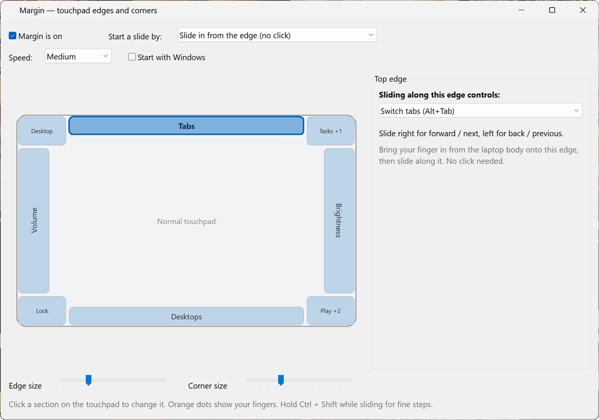
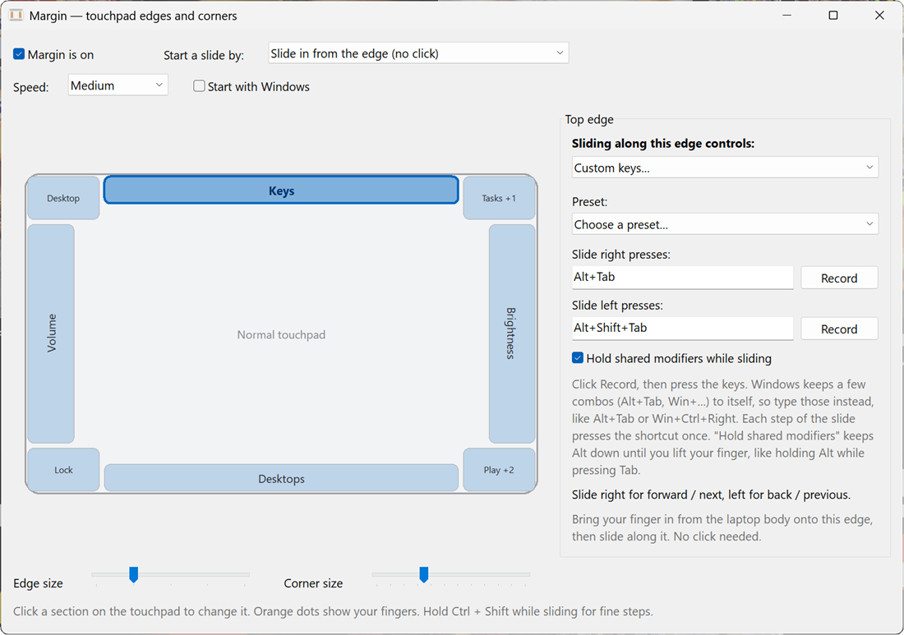
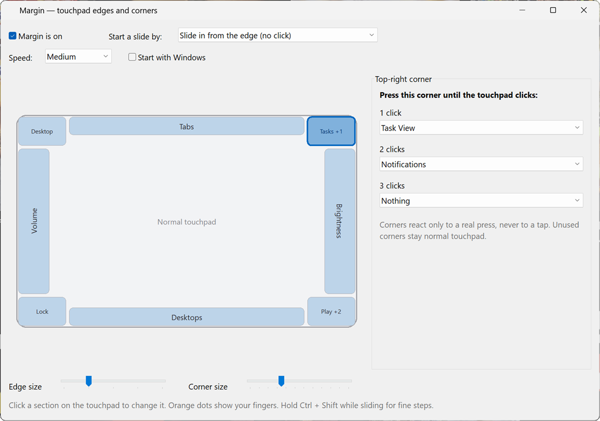
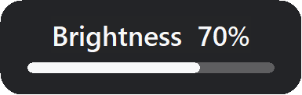

<p align="center">
  
</p>

<h1 align="center">Margin</h1>

<p align="center">
  <strong>Turn the edges and corners of your Windows touchpad into controls.</strong><br>
  Slide along an edge for volume, brightness, seeking or Alt+Tab. Press a corner to run anything. You choose what each one does.
</p>

<p align="center">
  
  
  
  
</p>

<p align="center">
  
</p>

Most laptop touchpads only use their middle for gestures. Margin uses the unused strip around the outside:

- **Slide a finger along an edge** to change volume or screen brightness, scrub a video, zoom, flip through windows or tabs, skip tracks, or switch virtual desktops. No function keys needed.
- **Press a corner** once, twice or three times to run a different action each time: mute, screenshot, lock the PC, open an app or website, press any shortcut, or run a command.
- **Record your own shortcuts** for each slide direction, so an edge can drive any app.

Everything in the middle of the touchpad stays a normal touchpad. Margin is a single native `margin.exe` of about 0.6 MB, needs nothing installed, uses no network and sends no telemetry.

## Contents

[Screenshots](#screenshots) · [Install](#install) · [Using Margin](#using-margin) · [Custom keys](#custom-keys) · [Settings file](#settings-file) · [Troubleshooting](#troubleshooting) · [How it works](#how-it-works) · [Build and test](#build-and-test) · [Related projects](#related-projects) · [License](#license)

## Screenshots

<table>
  <tr>
    <td width="50%"><br><sub><b>Custom keys.</b> Record a shortcut for each slide direction, or pick a preset.</sub></td>
    <td width="50%"><br><sub><b>Corners.</b> One, two or three presses each run a different action.</sub></td>
  </tr>
</table>

<p align="center">
  
  &nbsp;&nbsp;&nbsp;
  
  <br><sub>The small on-screen display for brightness and seeking. Volume uses the normal Windows volume flyout.</sub>
</p>

## Install

**Requirements:** Windows 10 or 11 with a **precision touchpad**. Check under *Settings → Bluetooth & devices → Touchpad*: it should say "Your PC has a precision touchpad". Brightness control works on the laptop's built-in screen, not on external monitors.

**Build from source** (needs the [Rust toolchain](https://rustup.rs) for the MSVC target and the "Desktop development with C++" build tools):

```powershell
git clone https://github.com/arxhr007/margin.git
cd margin
cargo build --release
```

The program is `target\release\margin.exe`. Copy it anywhere and run it.

Prebuilt downloads, when published, are on the [Releases](../../releases) page. Releases up to v0.2.1 are the earlier C# build of Margin; they work the same way and use the same settings file.

**First run.** The settings window opens. Afterwards Margin lives in the notification area: left-click its icon for settings, right-click for *Settings, On/Off, Open log, Quit*. Launching `margin.exe` again opens the settings of the copy that is already running. Tick **Start with Windows** to launch it at sign-in.

> The exe is not code-signed, so Windows SmartScreen may say "Windows protected your PC" the first time. Choose **More info → Run anyway**, or build it yourself from source.

## Using Margin

### Edges: slide along them

Click an edge on the touchpad map, then choose what sliding along it controls:

| Action | Slide one way | Slide the other way |
| --- | --- | --- |
| **Volume** | louder | quieter |
| **Screen brightness** | brighter | dimmer |
| **Seek video / audio** | forward (shows `+10s`) | back |
| **Zoom** | zoom in | zoom out (Ctrl + mouse wheel) |
| **Switch tabs / windows (Alt+Tab)** | next window | previous window (the Alt+Tab picker stays open until you lift your finger) |
| **Previous / next track** | next | previous |
| **Switch virtual desktops** | desktop to the right | desktop to the left |
| **Custom keys** | your shortcut | your other shortcut |

Slide **up or right** for "more / next" and **down or left** for "less / previous". Hold **Ctrl + Shift** while sliding for fine steps. The *Speed* setting changes how far you must slide per step.

### Two ways to start a slide

Pick one under *Start a slide by*:

- **Slide in from the edge** (default): bring a finger in from the laptop body onto the edge, then move along it. No click. A finger that first lands inside the touchpad, or any two-finger contact, never triggers it.
- **Press the edge until it clicks, then slide**: rest a finger on the edge, press until the touchpad clicks, and slide without letting go. The hardest to trigger by accident.

While a slide runs the pointer stays still and nothing is clicked underneath.

### Corners: press them

Press a corner until the touchpad physically clicks. Taps are ignored. Each corner can run a different action for **1, 2 or 3 presses**:

Mute · Play / pause · Next / previous track · Screenshot (Snipping Tool) · Task View · Show desktop · Lock the PC · Notifications · **Open an app** · **Open a website** · **Press a shortcut** · **Run a command** · Nothing

Defaults: top-left = show desktop, top-right = Task View (1 press) / notifications (2), bottom-left = lock, bottom-right = play/pause (1) / next (2) / previous (3). On the edges: left = volume, right = brightness, top = switch windows, bottom = switch virtual desktops.

The **Edge size** and **Corner size** sliders at the bottom of the window change how big each zone is. The map always shows the real zones, and orange dots show where your fingers are on the pad.

## Custom keys

Choose **Custom keys…** for an edge to make it send your own shortcuts.

1. Pick a **preset**, or click **Record** next to *Slide right presses* and press the keys.
2. Do the same for the other direction.
3. Tick **Hold shared modifiers while sliding** for Alt+Tab-style pickers: the modifiers both shortcuts share (Alt) stay down until you lift your finger.

Windows keeps a few combinations to itself (Alt+Tab, Win+…), so the Record button can't capture them. **Type them in the box instead.** Shortcut text looks like `Ctrl+Shift+Tab`, `Alt+Tab`, `Win+Ctrl+Right`, `Ctrl+PageDown` or `F11`.

| Preset | Slide right / up | Slide left / down | Hold |
| --- | --- | --- | --- |
| Switch windows | `Alt+Tab` | `Alt+Shift+Tab` | yes |
| Switch browser tabs | `Ctrl+Tab` | `Ctrl+Shift+Tab` | no |
| Next / previous tab | `Ctrl+PageDown` | `Ctrl+PageUp` | no |
| Scroll | `PageUp` | `PageDown` | no |
| Arrow keys | `Right` | `Left` | no |
| Redo / undo | `Ctrl+Y` | `Ctrl+Z` | no |

## Settings file

Settings are saved automatically to `%APPDATA%\Margin\settings.json`, so you can also edit them by hand (comments and trailing commas are allowed). Close Margin before editing, then start it again. The example below is shortened: a `sections` list that leaves a zone out leaves it unassigned, so list every zone you want to keep.

```json
{
  "enabled": true,
  "activation": "slideIn",
  "speed": "medium",
  "edgeDepth": 0.10,
  "cornerSize": 0.15,
  "entryStrip": 0.04,
  "sections": {
    "left":  { "slide": "volume" },
    "right": { "slide": "brightness" },
    "top": {
      "slide": "custom",
      "forward": "Alt+Tab",
      "back": "Alt+Shift+Tab",
      "holdModifiers": true
    },
    "bottomRight": {
      "clicks": [
        { "do": "playPause" },
        { "do": "nextTrack" },
        { "do": "url", "value": "https://example.com" }
      ]
    }
  }
}
```

| Field | Meaning |
| --- | --- |
| `activation` | `slideIn` or `press` |
| `speed` | `slow`, `medium` or `fast` |
| `edgeDepth`, `cornerSize` | size of the edge strips and corner squares, as a fraction of the touchpad |
| `entryStrip` | slide-in mode: how close to the edge a finger must first appear |
| `sections` | `left`, `right`, `top`, `bottom` (use `slide`) and `topLeft`, `topRight`, `bottomLeft`, `bottomRight` (use `clicks`) |
| `slide` | `off`, `volume`, `brightness`, `seek`, `zoom`, `tabs`, `tracks`, `desktops`, `custom` |
| `clicks[].do` | `none`, `mute`, `playPause`, `nextTrack`, `prevTrack`, `screenshot`, `taskView`, `showDesktop`, `lock`, `notifications`, `app`, `url`, `keys`, `command` |
| `clicks[].value` | the app path, address, shortcut or command line for `app`, `url`, `keys` and `command` |

## Troubleshooting

<details>
<summary><b>Nothing happens when I slide or press</b></summary>

- Check that you have a precision touchpad (see [Install](#install)). Touchpads that use an older, non-precision driver don't report finger positions to Windows, so Margin can't read them.
- Make sure the tray menu shows **On** ticked and the edge or corner is assigned (assigned zones are tinted on the map).
- Open the tray menu → **Open log**, or run `margin.exe --diag` from a terminal. It prints every touch frame and gesture, which shows whether Margin sees your finger and what it decides.
</details>

<details>
<summary><b>Brightness says "not available"</b></summary>

Brightness uses Windows' built-in display interface, which only exists for a laptop's own screen. External monitors and most desktop PCs don't have it.
</details>

<details>
<summary><b>Slides start when I only meant to move the pointer</b></summary>

Make the edge smaller with the **Edge size** slider, switch to **Press the edge until it clicks**, or turn that edge off by setting it to *Nothing*.
</details>

<details>
<summary><b>It doesn't work in one particular app</b></summary>

Windows doesn't let a normal program send keys to an app that runs **as administrator**. Run Margin as administrator too, or use it with that app closed. Some players use different shortcuts for seeking, so try *Custom keys* for the bottom edge.
</details>

<details>
<summary><b>The Record button won't capture Alt+Tab (or Win+…)</b></summary>

Windows handles those combinations before any program sees them. Type the text into the box instead, for example `Alt+Tab`.
</details>

<details>
<summary><b>Another touchpad utility reacts to the same edges</b></summary>

Some vendor touchpad tools (Synaptics, ELAN, Lenovo, ASUS and similar) have their own edge features. If both react, turn one of them off.
</details>

## How it works

- **Touch input:** Raw Input for the HID digitizer usage page `0x0D` / touchpad `0x05`, parsed with `HidP_*` (contact ID, tip switch, X/Y, contact count, button). It keeps working while other windows have focus.
- **Hiding clicks and freezing the pointer:** a `WH_MOUSE_LL` low-level mouse hook.
- **Volume, media keys and shortcuts:** `SendInput`.
- **Brightness:** WMI (`WmiMonitorBrightness` and `WmiSetBrightness`) on a background thread, with its own small on-screen display.
- **The settings window, tray icon and on-screen display:** plain Win32 with per-monitor DPI awareness. There is no UI framework and no runtime.

No network access, no telemetry. Margin only reads the touchpad and writes your settings and a small log file in `%APPDATA%\Margin`.

## Build and test

```powershell
cargo build --release      # target\release\margin.exe
cargo test                 # unit tests: settings, geometry, shortcut parsing, the gesture engine
```

Tests that use real hardware or the registry are marked `#[ignore]` and run on request:

```powershell
cargo test brightness_write -- --ignored --nocapture   # nudges the panel by 1 %, reads it back, restores it
cargo test startup_round_trip -- --ignored             # writes and removes the "start with Windows" value
```

Everything runs on the UI thread (raw input, the mouse hook and the windows share one message loop). The gesture logic has no Win32 calls in it, so it is unit-tested without a touchpad.

| Module | Role |
| --- | --- |
| `settings.rs` | settings model and JSON |
| `geometry.rs` | where each edge and corner sits on the pad |
| `engine.rs` | the gesture state machine; turns touch frames and clicks into effects (pure, tested) |
| `touchpad/` | Raw Input and HID parsing; fingers and button state |
| `hook.rs` | mouse hook: hides edge clicks, freezes the pointer during a slide |
| `keys.rs`, `actions.rs` | key presses, shortcut parsing, corner click actions |
| `brightness.rs` | built-in panel brightness through WMI |
| `hud.rs`, `tray.rs`, `icon_art.rs` | on-screen display, tray icon and menu, the icon artwork |
| `app.rs` | owns the state and the message loop; runs the engine's effects after the hook returns |
| `ui/` | the settings window: native controls, touchpad map, shortcut recorder |

`build.rs` embeds the manifest (per-monitor DPI, visual styles), version info and an icon generated from the same drawing code the tray uses. Developer flags: `--diag` (console with every touch frame) and `--hud-demo` / `--hud-demo-seek` (show the on-screen display for a few seconds).

Versions up to 0.2.1 were written in C# on .NET 8. That code is still in the git history and in the [v0.2.1 tag](../../tree/v0.2.1); the Rust version reads and writes the same `settings.json`.

## Related projects

Margin is not the only app that uses touchpad edges. If it doesn't fit your needs, these are worth a look:

- [Brim](https://github.com/joelgjojo/brim): edge controls for the Mac trackpad, with a Windows beta.
- [EdgeSlide](https://github.com/puttingpixelstogether-ops/edgeslide): Windows tray app that turns the left and right touchpad edges into brightness and volume sliders.

## License

MIT. See [LICENSE](LICENSE).
